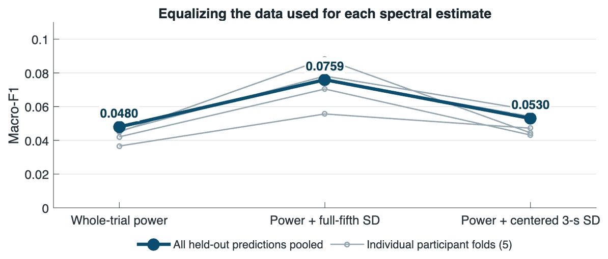

# Can EEG band-power variation distinguish 27 video conditions?

[中文讲解](README_CN.md)

A whole-trial average can hide changes in EEG power during a video. To test whether those changes help classify the stimulus condition, this project compared three Fourier-based representations of the same 2,335 recordings from 88 participants in EEGEmotions-27. Each prediction came from a model trained on other participants.

| Representation | Features | Correct / 2,335 | Accuracy | Macro-F1 |
|---|---:|---:|---:|---:|
| Whole-trial Welch baseline | 70 | 124 / 2,335 | 5.31% | 0.04798 |
| Whole-trial power + variability across five full segments | 140 | 187 / 2,335 | 8.01% | 0.07594 |
| Whole-trial power + variability across five centered 3-second blocks | 140 | 128 / 2,335 | 5.48% | 0.05301 |

With five full segments, adding band-power variability yielded 63 more correct predictions than whole-trial power alone (macro-F1 gain **+0.02796**). With two Welch windows per segment, the net gain fell to four correct predictions (**+0.00503** macro-F1). The 95% participant-bootstrap interval for this difference **[−0.00515, +0.01610]** spans zero, so a consistent advantage under this control remains uncertain. The control also limited the variability features to 15 seconds of each recording. Window count, temporal coverage, or both could explain the smaller gain. [Paired predictions](outputs/fixed_window_control/oof_predictions.csv) · [Scores by fold and inferred rate](outputs/fixed_window_control/metrics.csv) · [Prespecified control](fixed-window-control-plan.md)



## How the comparison works

- **Representation.** Each of 14 channels contributed log power in five bands (1–4, 4–8, 8–12, 12–30 and 30–40 Hz) estimated with 2-second Hann windows at 50% overlap. Both extensions kept those 70 whole-trial features and added the sample standard deviation of five segment log powers per channel and band. This measures the size of changes and is insensitive to segment order. [Representative power spectrum](outputs/features/representative_psd.png)
- **Window count.** With full fifths, a short recording supplied as few as 2 Welch windows per segment and a long one as many as 16. Taking the central 3 seconds of each fifth supplied exactly 2 windows in each of 11,675 blocks. [Extractor](src/extract_temporal_variability.m)
- **Evaluation.** All three EEG models used the same one-vs-all linear logistic classifier (ridge λ = 0.001) and five participant-held-out folds. Scaling and fitting used only the training participants. All participants viewed the same videos. Quality control used known condition labels across the dataset to infer effective rates and flag durations. The evaluation therefore concerns held-out participants under this fixed protocol. [Analysis contract](ANALYSIS_CONTRACT.md)
- **Data audit.** Within each condition, 41 participants had about half as many samples as the other 47. The spectral bandwidth supported inferred effective rates of 128 and 256 Hz, respectively. Acquisition and export histories are unknown. Forcing all records to 256 Hz gave a slightly higher baseline macro-F1 of 0.05092. [Data audit and rate evidence](DATA_AUDIT.md)

### Duration-only protocol diagnostic

Duration is sample count divided by inferred rate. Within each held-out fold,
the algorithm computes one median duration for each condition from the training
participants. It assigns each held-out trial to the nearest median and resolves
an exact tie with the lower condition ID. The diagnostic correctly classifies
`1813/2335 = 77.64%` and has pooled macro-F1 `0.71565`.

Duration was the sole input to this separate diagnostic. It quantifies how much the protocol reveals about the label. Its score does not identify which cues the EEG models used.

The whole-trial and full-segment EEG models each exceeded all 100 of their own within-participant label permutations. Those comparisons concern the individual models. The interval for the centered-block gain uses 2,000 paired resamples of participants, conditional on their saved predictions. [Full-segment permutations](outputs/temporal_extension/permutations.csv) · [Control metadata](outputs/fixed_window_control/metadata.json)

## Reproduce

The analysis was run in MATLAB R2025a Update 1 with Signal Processing Toolbox and Statistics and Machine Learning Toolbox. To check the packaged evidence without the raw recordings, run `run_tests()`, `verify_results()`, `verify_temporal_extension()` and `verify_fixed_window_control()`.

To rebuild from raw EEG, fetch the fixed data revision into the local data folder.

```bash
git clone --filter=blob:none --sparse --no-checkout \
  https://github.com/huytungst/EEGEmotions-27.git \
  data/raw/EEGEmotions-27

git -C data/raw/EEGEmotions-27 sparse-checkout set --no-cone \
  /eeg_raw/ /participants_info.csv \
  /emotivX_channels_location.ced /readme.md

git -C data/raw/EEGEmotions-27 fetch --depth 1 origin \
  0dfec14d177ed73c37a95f06d942e9b58e2bbf77
git -C data/raw/EEGEmotions-27 checkout --detach \
  0dfec14d177ed73c37a95f06d942e9b58e2bbf77
git -C data/raw/EEGEmotions-27 rev-parse HEAD
```

Run the three analysis stages from the repository root in MATLAB.

```matlab
run_all()                    % audit, features, baseline, persisted checks
run_temporal_extension()    % five-full-fifth SD extension
run_fixed_window_control()  % centered-3-s fifth SD extension and diagnostic
verify_fixed_window_control()
```

Inputs and file layout are described in the [data guide](data/README.md).

## Data and citation

The official [EEGEmotions-27 repository](https://github.com/huytungst/EEGEmotions-27)
licenses the dataset under CC BY-NC 4.0. Signal units and the precise
filtering, reference, and ICA history remain unspecified in the released files.

Phuong, H.-T., Im, E.-T., Oh, M.-S., & Gim, G.-Y. (2025). *EEGEmotions-27: A
Large-Scale EEG Dataset Annotated With 27 Fine-Grained Emotion Labels*. IEEE
Access, 13, 176915–176932. [doi:10.1109/ACCESS.2025.3620677](https://doi.org/10.1109/ACCESS.2025.3620677)
