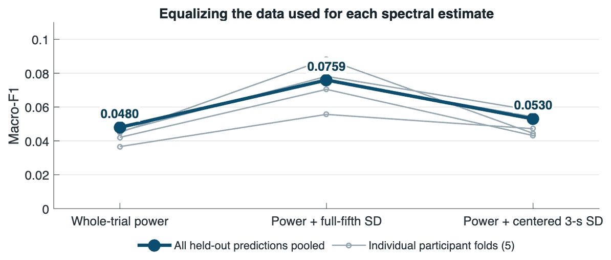

# 同一套视频下，能从脑电猜出刺激条件吗？

Bhaskar 教授给的练习允许任选方向。我们做了**分类**和**可视化**。输入是一位参与者观看一个视频时记录的 14 通道脑电（EEG），目标是从 27 个刺激条件中猜出这条记录对应哪一个。公开数据只收录参与者对目标情绪自评为 4 或 5 的试次。所有参与者都看同一套视频。[教授版英文 README](README.md) · [数据集](https://github.com/huytungst/EEGEmotions-27)

## 三次比较讲了什么？

三行对应同样的 88 位参与者、2,335 条试次和五个测试折。每条试次只有一个预测，这个预测来自没有用该参与者训练的模型。三次使用相同的线性分类器。

| 分类器看到的 EEG 特征 | 特征数 | 猜对的条数 | 准确率 | Macro-F1 |
|---|---:|---:|---:|---:|
| 整次观看的各频段功率 | 70 | 124 | 5.31% | 0.04798 |
| 整段功率，再加五段完整记录之间的功率波动 | 140 | 187 | 8.01% | 0.07594 |
| 整段功率，再加五段各取中心 3 秒后的功率波动 | 140 | 128 | 5.48% | 0.05301 |

**等窗后只比整段基线多猜对 4 条。** 两者逐条比较，有 95 条从错变对，91 条从对变错。原先五段波动带来的 macro-F1 增量为 0.02796，等窗后为 0.00503。对后一个差值按参与者重采样，95% 区间跨过零，因此等窗后能否稳定获得额外优势仍不确定。五个折中有四个略高于基线，但推断 128 Hz 组的 macro-F1 从 0.05602 降至 0.05208，256 Hz 组从 0.03817 升至 0.05377。对照同时统一了每段的窗数，也把计算波动所用的信号缩短到每条记录共 15 秒。两项改变各自对结果的影响仍难区分。

图中每条灰线代表一组留出的参与者。深色线把所有留出预测合起来，再计算一次 macro-F1。[逐条预测](outputs/fixed_window_control/oof_predictions.csv) · [总体、五折和采样率分组的结果](outputs/fixed_window_control/metrics.csv)

## 为什么会想到最后这个对照？

设想两条记录的平均 alpha 功率相近。一条始终平稳，另一条一会儿强、一会儿弱。只记一个平均数，很容易看漏它们的差别。于是我们保留原来的 70 个数，把每条试次分成五段，在每个通道和频段内再算一个数，表示这五段的对数功率相差多大。这个数是样本标准差，调换五段的次序也会得到同样的值。[第二阶段开始前的研究问题卡](research-question-card.md)

加进这 70 个波动特征后，有 139 条从猜错变成猜对，76 条从猜对变成猜错，净多对 63 条。长视频的每个五分之一也更长，用来估算功率的数据更多。这会不会影响结果？

以约 19 秒和 86 秒的记录为例。把它们分别等分为五段，每段约 3.8 秒和 17.2 秒。前者只能平均 2 个频谱窗，后者可平均 16 个。即使底层脑电波动相似，功率估计也可能因窗数不同而表现出不同的稳定性。时长线索本身相当强。用训练参与者的记录算出各条件的时长中位数，再给留出试次找时长最近的条件，能猜对 **1,813 / 2,335 条（77.64%）**。这个单独的诊断只读取时长，正好说明片长与条件的关联。[各条件时长](outputs/audit/condition_timing.csv)

等窗对照让每个五分之一都取正中间 3 秒。两个相互重叠的窗口分别覆盖其中的第 0–2 秒和第 1–3 秒。整段的原始 70 个特征和以人为单位的五折划分都沿用。这样能直接观察窗数相同后，波动特征的收益还剩多少。五个中心块一共只覆盖 15 秒，长视频各块之间也相隔更远。由此得到的结论仍然局限于这套取样方式和这些视频。[运行前的对照规则](fixed-window-control-plan.md) · [特征实现](src/extract_temporal_variability.m)

## 怎样读懂这些数字？

- **Welch 与 Fourier。** 先从每个电极的信号中取相互重叠的 2 秒短窗，每个窗做傅里叶变换，估计不同频率上的功率，再把各窗的功率谱平均。我们按 1–4、4–8、8–12、12–30、30–40 Hz 五个频段汇总，每段包含左端频率、排除右端频率。14 个电极乘 5 个频段，得到 70 个对数功率值。公开文件没有说明物理单位。[一条真实试次的功率谱](outputs/features/representative_psd.png)
- **准确率与 macro-F1。** 准确率是所有记录里猜对的比例。Macro-F1 先看每个类别有多少被找对、被猜成这类的又有多少是真的，再把 27 个类别的 F1 等权平均。论文式表格里的 0.05 macro-F1 和 5% 准确率是两项不同的指标。
- **标签置换。** 保留每个人的记录和类别数量，在各自记录内部打乱标签，每次重新训练并跑完五折。前两行各自超过其 100 次置换的最高 macro-F1（0.04655 和 0.04423）。经验值 1/101 比较的是对应完整模型与打乱标签的结果。模型之间的差值另按配对预测计算。[整段置换](outputs/modeling/structured_permutation_baseline.csv) · [五段置换](outputs/temporal_extension/permutations.csv)
- **等窗比较有多确定？** 等窗与基线的 macro-F1 差值为 +0.00503。以参与者为单位计算的区间为 [-0.00515, +0.01610]，覆盖了零。 这里每次有放回地抽取 88 位参与者，每位带上自己的全部配对预测，共 2,000 次。这个 95% 百分位区间描述现有预测随参与者抽样的波动。重新训练模型、换一批视频时的不确定性还在这个范围之外。[区间及运行参数](outputs/fixed_window_control/metadata.json)

## 用这批数据时，哪两个决定最重要？

**一是怎样把采样点换算成秒。** 数据集文档写 256 Hz，但同一视频在 41 位参与者的记录中，采样点数约为另外 47 位的一半。频谱带宽也支持这种分组。我们据此采用 128/256 Hz 两种**推断的有效输出采样率**。公开信息无法确定差异发生于采集还是导出。整段模型如果把所有人都按 256 Hz 处理，macro-F1 为 0.05092，略高于主分析的 0.04798。[采样率诊断图](outputs/audit/sampling_rate_diagnostic.png) · [全按 256 Hz 的对照](outputs/sampling_rate_sensitivity/metrics.csv)

**二是怎样留出参与者。** 2,343 个原始文件中，一个只有一行，另七个偏离所属条件的典型时长超过 5%，主分析保留 2,335 个。恢复这七个文件后，第一阶段整段模型的 macro-F1 为 0.04789。数据审计用了全体记录及已知刺激标签来推断采样率和判断异常。随后模型按参与者分五折，每折仅用训练人的数据拟合标准化和分类器。因此这里检验的是**已知协议和数据集质控下，对留出参与者的刺激条件预测**。换成陌生视频，或者要在不知道条件的情况下处理全新记录，还需要另外的证据。[文件审计](DATA_AUDIT.md) · [参与者分折](outputs/modeling/participant_fold_assignment.csv)

## 怎样复查？

1. 打开仓库中的 CSV 即可，按试次 ID 对照三版预测。五折的训练集互有重叠，五个分数提供方向与分布的描述。
2. 在 MATLAB 项目根目录运行 `run_tests()`、`verify_results()`、`verify_temporal_extension()`、`verify_fixed_window_control()`，可以用仓库中的文件复核已保存的结果。
3. 要从原始 EEG 重建，先按[英文复现步骤](README.md#reproduce)取得固定版本的数据，再依次运行 `run_all()`、`run_temporal_extension()`、`run_fixed_window_control()`。
